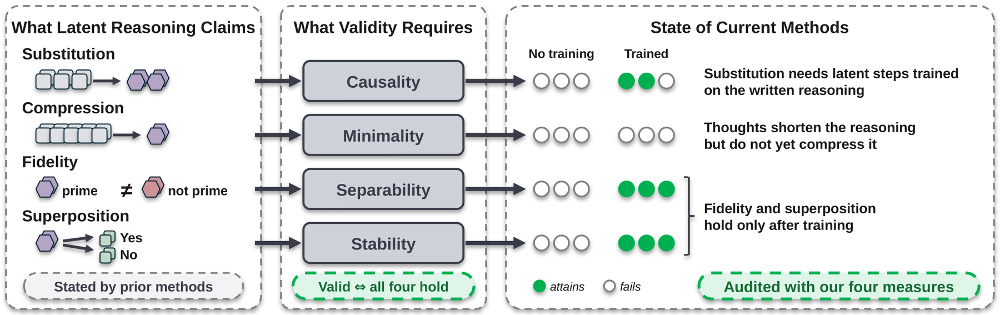

<div align="center">

# What Makes a Latent Thought Valid?<br>Defining and Auditing Thought Representations in LLMs

**Fahd Seddik** · **Fatemeh Fard**

FARD Lab, University of British Columbia

<a href="https://arxiv.org/abs/2606.27378"></a>
<a href="https://huggingface.co/papers/2606.27378"></a>
<a href="https://fard-lab.github.io/valid-thoughts/"></a>
<a href="https://github.com/FARD-Lab/valid-thoughts"></a>
<a href="https://x.com/HuggingPapers/status/2071640950628053248?s=20"></a>
<a href="https://www.linkedin.com/posts/fahd-seddik_artificialintelligence-largelanguagemodels-activity-7477185280475561984-PdWa"></a>
<a href="https://www.wispaper.ai/en/user-blog/formalizing-latent-thoughts-four-axioms-thought-representation-llms-20260630/eng"></a>
<a href="https://dailyaiwire.news/article/llm-latent-thought-representations-fail-axiomatic-evaluation"></a>
<a href="LICENSE"></a>

</div>

---

<p align="center">
  
</p>

---

## News

**[2026.06.30]** Check out the [WisPaper blog](https://www.wispaper.ai/en/user-blog/formalizing-latent-thoughts-four-axioms-thought-representation-llms-20260630/eng) and [Daily AI Wire article](https://dailyaiwire.news/article/llm-latent-thought-representations-fail-axiomatic-evaluation) covering our research!

**[2026.06.29]** Our paper is featured as [🤗 HuggingFace #1 Paper of the Day](https://huggingface.co/papers/2606.27378)!

**[2026.06.29]** Covered by AK on [X / HuggingFace Daily Papers](https://x.com/HuggingPapers/status/2071640950628053248?s=20).

**[2026.06.29]** Paper launch: [X announcement](https://x.com/fahdseddik/status/2071422248745869680?s=20) and [LinkedIn post](https://www.linkedin.com/posts/fahd-seddik_artificialintelligence-largelanguagemodels-activity-7477185280475561984-PdWa).

**[2026.05.07]** We have released our paper on [arXiv](https://arxiv.org/abs/2606.27378)!

---

Official implementation of the paper.
It computes causality, minimality, separability, and stability for the training-free audit on BBEH and the trained audit on GSM8K.

## Setup

Requires Python 3.12, CUDA 12.6, and [uv](https://github.com/astral-sh/uv).

```bash
uv sync
cp .env.example .env                              # add your Hugging Face token
uv run python -m scripts.download.download_bbeh
git submodule update --init third_party/colar     # trained audit only
uv run python -m scripts.download.download_latent_audit
```

Without the git history, clone [CoLaR](https://github.com/xiaomi-research/colar) into `third_party/colar` at commit `4d8aced1b0e17db0c52ea14dacf4f77c0543fdc4`.

## Training-Free Audit (BBEH)

Run each block once per model, with `MODEL` set to `llama_8b`, `llama_70b`, `deepseek_r1_32b`, `skywork_or1_32b`, or `gpt_oss_20b`.

```bash
MODEL=llama_8b

# Outputs and thought representations
uv run python -m scripts.llm_data model=$MODEL output_dir=outputs/llm_data_$MODEL
uv run python -m scripts.disc_index                # once, the splits are shared by all models
uv run python -m scripts.disc_data model=$MODEL llm_data_output_dir=outputs/llm_data_$MODEL output_dir=outputs/disc_data_$MODEL

# Measures
uv run python -m scripts.separability_eval --disc-data-dir outputs/disc_data_$MODEL --llm-data-dir outputs/llm_data_$MODEL --out-dir outputs/separability/$MODEL
uv run python -m scripts.dcs_d_eval --models $MODEL --out outputs/stability_$MODEL.csv
uv run python -m scripts.causality_native_eval model=$MODEL tr_data_dir=outputs/disc_data_$MODEL llm_data_dir=outputs/llm_data_$MODEL output_dir=outputs/causality_native/$MODEL swap=true
uv run python -m scripts.minimality_native_eval model=$MODEL tr_data_dir=outputs/disc_data_$MODEL llm_data_dir=outputs/llm_data_$MODEL output_dir=outputs/minimality_native/$MODEL
```

Each measure writes a JSON summary to its output folder, and stability writes a CSV.

## Trained Audit (GSM8K)

Audits CODI, SIM-CoT, and CoLaR next to the training-free methods on their base model, Llama-3.2-1B-Instruct.

```bash
uv run python -m scripts.latent_audit_data --split test
uv run python -m scripts.latent_audit_embed --data-dir outputs/latent_audit/shards/test_00000_01319
uv run python -m scripts.latent_audit_eval --data-dir outputs/latent_audit/shards/test_00000_01319 --measures causality minimality
uv run python -m scripts.latent_audit_merge
uv run python -m scripts.latent_audit_eval --data-dir outputs/latent_audit/merged --reuse-records
```

`--start` and `--end` split the questions into shards that can run in parallel, and `latent_audit_merge` joins them.
To audit the GPT-2 versions of CODI and SIM-CoT, pass `--methods codi_gpt2 sim_cot_gpt2` to every step and write them to their own folders.
Set the folders with `--out-dir` of `latent_audit_data`, `--shards-dir` and `--out-dir` of `latent_audit_merge`, and `--data-dir` of the other steps.

## Citation

```bibtex
@misc{seddik2026makeslatentthoughtvalid,
  title         = {What Makes a Latent Thought Valid? Defining and Auditing Thought Representations in LLMs},
  author        = {Fahd Seddik and Fatemeh Fard},
  year          = {2026},
  eprint        = {2606.27378},
  archivePrefix = {arXiv},
  primaryClass  = {cs.CL},
  url           = {https://arxiv.org/abs/2606.27378}
}
```

## License

MIT, see [LICENSE](LICENSE).
